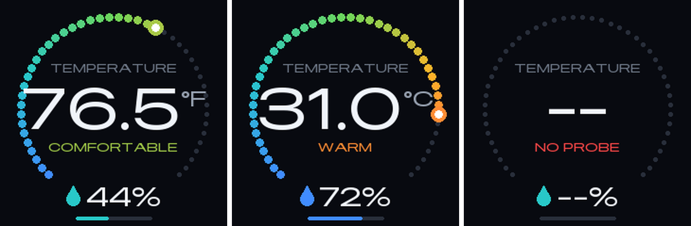
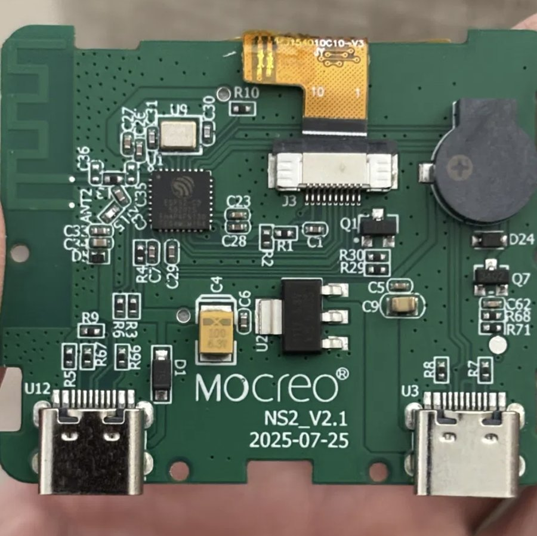

# MOCREO NS2 — ESPHome

ESPHome firmware for the **MOCREO NS2 Wi-Fi Thermo-Hygrometer** (probe variant, board
`NS2_V2.1`). It replaces the stock cloud firmware with a local, Home Assistant–native device
that has a full-colour dashboard on the built-in 240×240 IPS screen.

<p align="center">
  <br>
  <em>Dashboard layout (mock-up). Left to right: °F reading, a warm °C reading, no probe connected.</em>
</p>

> **Status:** running on a real unit. The display, backlight, button and SHT40 sensor are
> verified on hardware. Screen rotation at 180°/270° hasn't been tested yet (see
> [Known issues](#known-issues)).

## Features

- **Dashboard:** a 270° temperature ring (10–35 °C) with a colour gradient, a large
  reading, a COOL / COMFORTABLE / WARM label, and humidity with a fill bar
- **Temperature & humidity** from the probe's Sensirion SHT40, every 30 s
- **°F / °C** switchable from the button, saved across reboots
- **Dimmable backlight**, adjustable from Home Assistant or the button, saved across reboots
- **Screen rotation** (0 / 90 / 180 / 270°) from Home Assistant, applied without a reflash
- **ESP32-C3 chip temperature** as a diagnostic sensor, also shown in the screen corner
- No cloud, no app: Wi-Fi, native API and OTA, all encrypted

## Hardware

<p align="center"></p>

| | |
|---|---|
| SoC | ESP32-C3 (QFN32) with 4 MB embedded flash, no PSRAM |
| Display | 240×240 ST7789 IPS, 4-wire SPI, 10-pin FPC (J3) |
| Sensor | Sensirion SHT40 at I²C `0x44`, **inside the external probe** |
| Ports | **U12** USB-C: power + USB-Serial-JTAG (flashing). **U3** USB-C: probe connector only |
| Other | Piezo buzzer, one button, AO3402 N-MOSFET backlight switch, SOT-223 3.3 V LDO |

### Pin map

| Function | GPIO | Notes |
|---|---|---|
| SPI MOSI | 7 | SPI2 at 10 MHz, no MISO |
| SPI SCLK | 6 | |
| LCD CS | 5 | |
| LCD DC | 4 | |
| LCD RST | 8 | Has a pull-up |
| Backlight | 3 | **Active high**, LEDC PWM into a low-side MOSFET gate |
| Button | 9 | **Active low**, external pull-up. Also the boot strapping pin |
| I²C SDA | 2 | To the probe via U3 |
| I²C SCL | 1 | To the probe via U3 |
| Buzzer | 20 | Piezo (not used by this config yet) |
| USB D− / D+ | 18 / 19 | USB-Serial-JTAG on U12 |

The SPI pins were read straight out of the stock firmware's native LCD driver. The
backlight and button were confirmed by driving the remaining free pins from Home Assistant.
There's no I/O expander on the board.

## Install

1. **Back up the stock firmware first.** Connect U12 to your computer and run:
   ```sh
   esptool.py --chip esp32c3 read_flash 0 0x400000 ns2_stock_backup.bin
   ```
   Writing that file back at `0x0` restores the original firmware.
2. Copy `esphome/mocreo-ns2.yaml` into your ESPHome dashboard, and create `secrets.yaml`
   from [`esphome/secrets.yaml.example`](esphome/secrets.yaml.example). Generate `api_key` with
   `openssl rand -base64 32`.
3. **The first flash must be over USB** (U12), using the ESPHome dashboard or
   [web.esphome.io](https://web.esphome.io). If the board isn't detected, hold the button
   while plugging in the cable to force download mode. Later updates go over the air.
4. Plug in the probe (U3) and adopt the device in Home Assistant.

OTA uses `encryption:` with no key of its own, so it reuses the API encryption key.

## Using it

### Button

| Press | Action |
|---|---|
| Short (< 0.6 s) | Toggle °F / °C (defaults to °F) |
| Long (1–5 s) | Step backlight 25 → 45 → 70 → 100 % |

Don't hold the button while powering the device on: GPIO9 is the boot strapping pin, so
the chip will start in download mode instead of running the firmware.

### Home Assistant entities

| Entity | Type | |
|---|---|---|
| Temperature | sensor | °C from the SHT40, every 30 s |
| Humidity | sensor | %RH from the SHT40 |
| Backlight | light | Dimmable. Starts at 40 % on first boot, then remembers the last level |
| Screen Rotation | select | 0° / 90° / 180° / 270°, saved |
| Button | binary sensor | Raw button state, usable in automations |
| ESP Temperature | sensor (diagnostic) | ESP32-C3 die temperature, every 60 s |

### Dashboard details

- **Ring:** 46 dots covering 10–35 °C, shading blue → teal → green → amber → red, with a
  white-centred marker at the current reading.
- **Comfort label:** COOL below 18 °C, COMFORTABLE from 18 to 26 °C, WARM above 26 °C.
- **Humidity colour:** amber below 30 %, teal from 30 to 60 %, blue above 60 %.
- **No probe:** the screen shows `--` and *NO PROBE*.
- The screen redraws on every new reading and on button presses. The font is
  [Inter](https://rsms.me/inter/) from Google Fonts.

## Design notes

- **RAM:** the C3 has no PSRAM, and a full 240×240×16-bit framebuffer (115 KB) won't fit
  as one block with Wi-Fi running. The display uses `buffer_size: 25%` (28.8 KB) and draws
  in four passes. This is also why the UI uses ESPHome's drawing primitives instead of LVGL.
- **Backlight heat:** the panel runs noticeably warm at full brightness, hence the 40 %
  default. Brightness is gamma-corrected (2.8), so 40 % is about 8 % actual PWM duty.
- **Logger:** `baud_rate: 0`, so all logs go over the API. `level: DEBUG` is required to
  see the I²C bus scan at boot.

## Known issues

- **Rotation at 180° / 270° is untested.** If the image shows up shifted, with a band of
  noise, the panel controller has 240×320 RAM and needs an 80 px offset at those angles.
  Please open an issue if you see this.
- The buzzer (GPIO20) is wired but not used yet.

## License

[MIT](LICENSE). Not affiliated with or endorsed by MOCREO. Flashing replaces the stock
firmware and disables the MOCREO app and cloud. Keep your backup.
